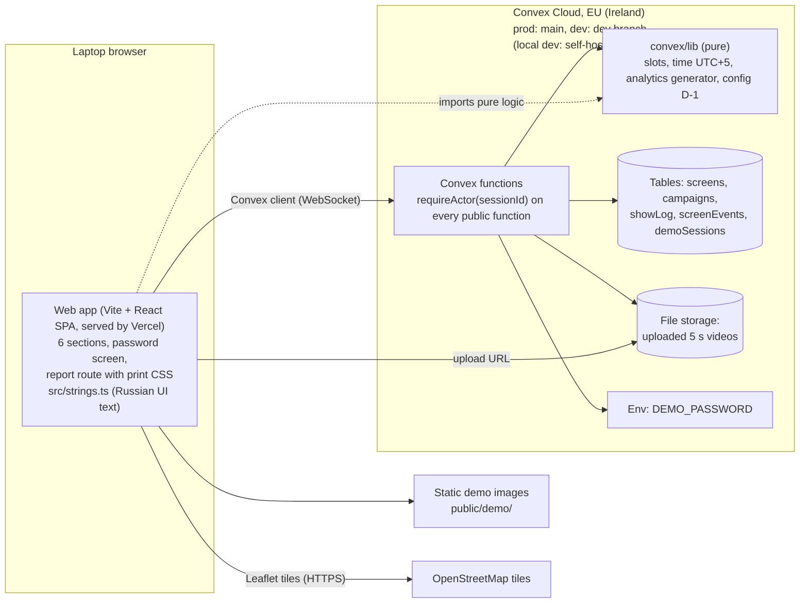

Status: approved 2026-10-28 (auto)

# Architecture: billboard-management

Version 0.2, 2026-10-29 (hosting updated for ADR-0012). Version 0.1, 2026-10-28, drafted by the architect agent from `docs/SoW.md` (approved 2026-10-28), `PRODUCT.md`, the project `CLAUDE.md`, `docs/explainer/index.html` and `docs/client/ТЗ на демо - Наружная реклама (final).pdf` (below: ТЗ).

## 1. Context

BillBoard owns about 100 digital billboards in Astana, Karaganda, Atyrau and the East Kazakhstan region (SoW §1). Phase 1 is an interactive web demo of the future platform: network state, campaigns with 5-second slots, schedule, occupancy, simulated audience analytics and a printable advertiser report (F-1 to F-11). Nothing connects to real screens or cameras; simulated values carry «Демонстрационные данные» (ТЗ §1, §5). One working role, R-1 «Администратор сети / владелец билбордов»; R-2 «Рекламодатель» only receives the printed report (SoW §3). Deadline: 2026-10-31, 3 days (K-01). The demo ran locally first (user, 2026-10-28). Hosting is Convex Cloud (EU) + Vercel, deployed by GitHub Actions (User decision, 2026-10-29, ADR-0012).

## 2. Constraints

| Constraint | Value | Source |
| --- | --- | --- |
| Backend | Convex Cloud, EU region (Ireland, `aws-eu-west-1`); self-hosted Docker for local dev only. Was "self-hosted (Docker on own VM)" until 2026-10-29 | project `CLAUDE.md`; User decision, 2026-10-29 (ADR-0012) |
| Hosting | Front on Vercel (`*.vercel.app` for now), backend on Convex Cloud; no Azure. Deploy: GitHub Actions, `main` → Convex prod + Vercel Production, `dev` → Convex dev + Vercel Preview | project `CLAUDE.md`; User decision, 2026-10-29 (ADR-0012) |
| Data residency | "Data residency \| none". No personal data in the demo. | project `CLAUDE.md`; ТЗ §10 |
| Personal data | None: synthetic data only; no photos of people, no names, no face identification | ТЗ §10, SoW §5, F-8 AC4, F-11 AC5 |
| Security level | "Security level: demo"; "Development and test use synthetic or anonymized data only." | project `CLAUDE.md` |
| Access | One shared password, no user accounts, all viewers share data (D-13) | SoW §3, §5 |
| Permissions | "Permissions are enforced server-side in Convex functions." | project `CLAUDE.md` |
| UI language | Russian only; "UI strings are in Russian only, from one shared strings module." Currency tenge, no prices (D-11) | project `CLAUDE.md`; ТЗ §3 |
| Platform | Desktop browser, laptop screen; no mobile layout | SoW §5, §9.9 |
| Slot model | 60 s cycle, 12 slots of 5 s, one setting (D-1); check per screen × day × hour (D-9) | SoW §8.1 |
| Map | Leaflet + OpenStreetMap; list works without the map (D-7) | SoW §8.1 |
| Report export | Browser print with a print stylesheet only (D-12) | SoW §8.1 |
| Integrations | OSM tiles only; no screens, players, cameras, payments, report sending | SoW §6, §9 |
| Deadline | 2026-10-31 | SoW §2.1 |
| Acceptance environment | Local laptop stack for the 2026-10-31 meeting (ADR-0011). The pipeline `test` stack is the Convex production deployment from `main` + Vercel Production (synthetic seed, client review). Deviates from SoW §7.1 ("deploys the demo to the test stack on Azure"); the SoW stays as approved. The real `prod` (personal data) is a later decision | User decision, 2026-10-28 (OQ-1, ADR-0011); User decision, 2026-10-29 (ADR-0012) |

## 3. Components

Apps: one desktop web app plus the Convex backend (ADR-0001). No admin/client split, no mobile app: R-1 is the only role with access, R-2 has no account in phase 1.

Hosting (ADR-0012): Vercel serves the static front build with the security headers from `vercel.json`; the browser talks to Convex Cloud directly. GitHub Actions deploys: `main` → Convex production deployment + Vercel Production; `dev` → Convex development deployment + Vercel Preview. `deploy/compose` (self-hosted Convex in Docker) runs local dev and e2e only.

## 4. Data flow

1. **Sign-in (F-1)**: the browser makes a random `sessionId`, sends it with the password to `demo.signIn`. On match with `DEMO_PASSWORD`, Convex stores the session. Every later call carries `sessionId`; `requireActor` rejects calls without a valid session (ADR-0003).
2. **Reading views (F-2, F-3, F-4, F-7, F-8, F-9)**: queries read the 100 screens and all campaigns and compute occupancy, the 12-slot cycle, planned shows and notifications with `convex/lib/slots.ts`; analytics come from the deterministic generator `convex/lib/analytics.ts`; shows by the log come from `showLog` (ADR-0004, ADR-0005). All views use the same functions, so the card, the schedule and the report agree.
3. **Creating a campaign (F-6)**: the form calls `campaigns.checkAvailability` for the live preview (availability, planned shows, conflicts). Save calls `campaigns.create`, which repeats the check inside the transaction and rejects on conflict with structured conflict data; the front turns it into the message from `src/strings.ts`. Optional video: `campaigns.generateUploadUrl`, browser upload, `storageId` passed to `create` (ADR-0008).
4. **«Смоделировать показы» (F-10)**: `showLog.simulate` replaces the campaign's log rows with per-day counts for past hours on online screens, never above plan (ADR-0007). Convex reactivity updates the open report and dashboard.
5. **«Сбросить демо» (F-1)**: after the confirm dialog, `demo.reset` deletes domain tables and uploaded files and reruns the seed with dates relative to today, in one transaction (ADR-0006).
6. **Print (F-9)**: the report route prints through `window.print()` with `src/print.css` (ADR-0010).

## 5. Decisions

| # | Decision | Why | ADR |
| --- | --- | --- | --- |
| 1 | One desktop SPA (Vite, React, TS, React Router, Mantine core/dates/charts) + Convex backend; report is a route | One role, R-2 has no account; least code for a 3-day deadline | [0001](0001-app-split-and-frontend-stack.md) |
| 2 | Single package: `src/`, `convex/`, `convex/lib/` shared pure logic, `src/strings.ts` the only Russian text; backend returns codes | One app; matches Convex template and `.fde-echo.json` paths | [0002](0002-repo-layout-and-shared-code.md) |
| 3 | Shared password in Convex env, session table, `requireActor(sessionId)` in every public function | Server-side control without accounts; works locally and on Azure | [0003](0003-demo-access-shared-password.md) |
| 4 | Campaigns store compact rules; occupancy, slots, plan and conflicts computed on read; fixed UTC+5; cycle constant D-1 | Tens of documents instead of tens of thousands; one source of truth; within Convex limits | [0004](0004-data-model-and-slot-occupancy.md) |
| 5 | Audience analytics from a deterministic generator, not stored | Same numbers everywhere; no scan-limit or reset cost | [0005](0005-simulated-audience-analytics.md) |
| 6 | Deterministic seed with dates relative to today; one atomic reset mutation | Statuses stay right on any reset day; one code path | [0006](0006-seed-and-demo-reset.md) |
| 7 | Show log as rows per campaign × screen × day, replaced on each simulate run | Log stays a separate record from plan; small; idempotent | [0007](0007-simulated-show-log.md) |
| 8 | Placeholders and screen images static; optional video in Convex file storage, type and size checked on the server, duration in the browser | No extra service; video upload is first to cut (K-01) | [0008](0008-creatives-and-file-storage.md) |
| 9 | `react-leaflet` + OSM tiles, lazy, in an error boundary | D-7; list stays usable when the map fails | [0009](0009-map-leaflet-osm.md) |
| 10 | Same report route with `@media print`; `window.print()` | D-12; no second layout | [0010](0010-report-print.md) |
| 11 | Acceptance on the local laptop stack (OQ-1); vitest + convex-test + Playwright. Hosting and backups part superseded by 0012 | Fixed self-hosted mode at the time; cheapest | [0011](0011-environments-hosting-backups.md) (superseded) |
| 12 | Convex Cloud EU + Vercel; GitHub Actions: `main` → prod/Production, `dev` → dev/Preview; Convex Cloud backups (daily, with files); headers in `vercel.json`; compose for local dev only | User decision, 2026-10-29; both services already on Pro; no servers to run | [0012](0012-hosting-convex-cloud-vercel-ci.md) |

### Decision areas

| Area | Result |
| --- | --- |
| App split | One web app + Convex backend (ADR-0001). |
| Repo structure, shared code | Single package; `convex/lib/` and `src/strings.ts` (ADR-0002). |
| Auth | Shared password, session table (ADR-0003). |
| Authorization | Single role R-1; `requireActor` server-side in every public Convex function (ADR-0003). No per-record rules: all viewers share all data (D-13). |
| Convex mode | Convex Cloud, EU region (ADR-0012); self-hosted Docker for local dev; `convex-test` for unit tests (ADR-0011). |
| Hosting and data residency | Vercel (front) + Convex Cloud EU (backend), `*.vercel.app` for now (ADR-0012). Residency: none; no personal data. Real `prod` with personal data: later decision. |
| Backups | Seed + reset; Convex Cloud backups on the production deployment: daily automatic with file storage, «Backup Now» before schema changes (ADR-0012). |
| Azure / AI | Not applicable: no feature calls a model (SoW §4, §9). |
| Maps and geo | Leaflet + OSM, synthetic coordinates, no geocoding (ADR-0009). |
| Notifications | In-app list on «Главная» only, computed from screen status and campaign end dates (D-5); no provider (SoW §6.1, ADR-0004). |
| Mobile | Not applicable: desktop laptop only, mobile layout out of scope (SoW §9.9). |
| Files and imports | Optional 5 s video upload to Convex storage; no data imports (ADR-0008). |
| Observability | Convex dashboard logs per deployment, Vercel deployment logs; no error tracker, no audit log (SoW §5, ADR-0012). |
| Environments and CI/CD | GitHub Actions; `main` → Convex prod + Vercel Production (pipeline `test` stack); `dev` → Convex dev + Vercel Preview; deploy keys in GitHub secrets (ADR-0012). |
| Testing | vitest + convex-test; Playwright e2e for the SoW §7.3 scenario; synthetic seed only (ADR-0011). |

### Not built (not in the SoW)

Campaign edit and delete (OQ-4, auto), sign-out, settings UI for the cycle length, prices (D-11), automatic PDF (SoW §9.7), user accounts (SoW §9.5).

## 6. Vendor facts checked

| Fact | Result | Source, date |
| --- | --- | --- |
| Self-hosted Convex: compose, ports 3210/3211/6791, SQLite default, Postgres/MySQL optional, files in Docker volume or S3, Convex Auth needs manual setup | Verified | github.com/get-convex/convex-backend `self-hosted/README.md`, 2026-10-28 |
| Convex limits: 32 000 docs scanned, 4 096 index ranges, 16 MiB read, 16 000 docs written, 1 s user code per query/mutation | Verified | docs.convex.dev/production/state/limits, 2026-10-28 |
| `npx convex export --include-file-storage --path` exists | Verified (cloud CLI docs); works the same on self-hosted: UNVERIFIED | docs.convex.dev/cli, 2026-10-28 |
| `npx convex import` replace flags for a full restore on self-hosted | UNVERIFIED | — |
| Convex runtime: `Math.random` seeded per run, `Date.now` frozen per call | Verified | docs.convex.dev/functions/runtimes, 2026-10-28 |
| Convex Cloud regions: EU = Ireland `aws-eu-west-1`, 1.3x usage price, region fixed per deployment | Verified | docs.convex.dev/production/regions, 2026-10-29 |
| Deploy keys for any cloud deployment incl. dev (`dev:`), dashboard or `npx convex deployment token create` | Verified; `npx convex deploy` with a `dev:` key read from CLI 1.48.0 source, not in docs | docs.convex.dev/cli/deploy-key-types, 2026-10-29 |
| `npx convex deploy --cmd` sets `VITE_CONVEX_URL` for a Vite project; `--cmd-url-env-var-name` overrides | Verified (CLI 1.48.0 source; docs say "CONVEX_URL (or similar)") | docs.convex.dev/production/hosting/vercel, 2026-10-29 |
| Convex Cloud backups: manual 7 days; daily 7 / weekly 14 days (Pro); optional file storage; restore wipes data | Verified | docs.convex.dev/database/backup-restore, 2026-10-29 |
| Upload URLs: file size not limited, 2 min POST timeout, URL valid 1 h | Verified | docs.convex.dev/file-storage/upload-files, 2026-10-29 |
| Production redacts server errors; dev deployments do not | Verified | docs.convex.dev/functions/error-handling, 2026-10-29 |
| `vercel build` passes CI env `VITE_CONVEX_URL` to the Vite build | UNVERIFIED; check when the workflow is written | — |
| OSM tile policy: visible attribution, Referer, no bulk/offline, may be withdrawn without notice | Verified | operations.osmfoundation.org/policies/tiles, 2026-10-28 |
| Leaflet 1.9.x stable; 2.0 in alpha | Verified (2.0 alpha banner); compatible `react-leaflet` major: UNVERIFIED | leafletjs.com, 2026-10-28 |
| Kazakhstan single time zone UTC+5 since 2024-03-01 | Verified | Interfax, Meduza, Microsoft tech community (2024), searched 2026-10-28 |
| Current Mantine and React majors | UNVERIFIED; pinned at scaffold | — |

## 7. Answered questions

| ID | Question | Decision | Reason | ADR |
| --- | --- | --- | --- | --- |
| OQ-1 | Where does the 2026-10-31 acceptance run? | Local laptop stack for the meeting; Azure test stack later. Deviation from SoW §7.1 recorded in §2 and ADR-0011. | User decision, 2026-10-28 (user said: run locally for now). | 0011 |
| OQ-2 | Azure region and public URL for the later deploy | No Azure. Convex Cloud EU (Ireland) + Vercel, default `*.vercel.app` domain for now. | User decision, 2026-10-29. | 0012 |
| OQ-3 | Audience analytics for screens without a camera? | Screens without a camera show «нет камеры» and are left out of audience totals; the seed gives cameras to most screens. (auto) | Auto: recommended answer, 2026-10-28. No estimate looks confirmed (PRODUCT.md principle 1); «камера да / нет» stays meaningful. | 0005, 0006 |
| OQ-4 | Build campaign edit and delete? | Not built in phase 1; «Сбросить демо» covers cleanup. (auto) | Auto: recommended answer, 2026-10-28. Not in F-5/F-6; 3-day deadline (K-01). | 0004 |
| OQ-5 | Seed dates relative or fixed? | Relative to the reset day. (auto) | Auto: recommended answer, 2026-10-28. Statuses of the named seed campaigns (F-5 AC1) stay right on any reset day. | 0006 |

## 8. Open questions

Only items the inputs do not decide. Each has a recommended answer.

| ID | Question | Options | Recommendation and reason | Affects | Owner |
| --- | --- | --- | --- | --- | --- |
| OQ-6 | Vercel Preview access (the `dev` deployment does not redact server errors) | a) Keep Vercel Authentication on Preview (team only). b) Open Preview to anyone with the link. | **a**: only the team needs Preview; the client reviews Production. | ADR-0012 | Team, at the first `dev` deploy |
| OQ-7 | Target of the real `prod` (personal data) | a) A separate Convex project + Vercel project, region per `docs/PERSONAL-DATA.md`. b) Re-designate the current production deployment after a data wipe. | **a**: keeps synthetic test data and real data apart; the region may need to change (Kazakhstan storage rule, `docs/PERSONAL-DATA.md` row 2), and a Convex region cannot change in place. | ADR-0012 | User, at the production deploy gate |

Client items carried from the SoW (phase 2, do not block phase 1): Q-01 phase 2 content and deadline, Q-02 backup needs, Q-03 users and response time, Q-04 commercial slot model, Q-05 prices, Q-06 confirm D-3 and D-4. Personal-data rows for production: `docs/PERSONAL-DATA.md`.
