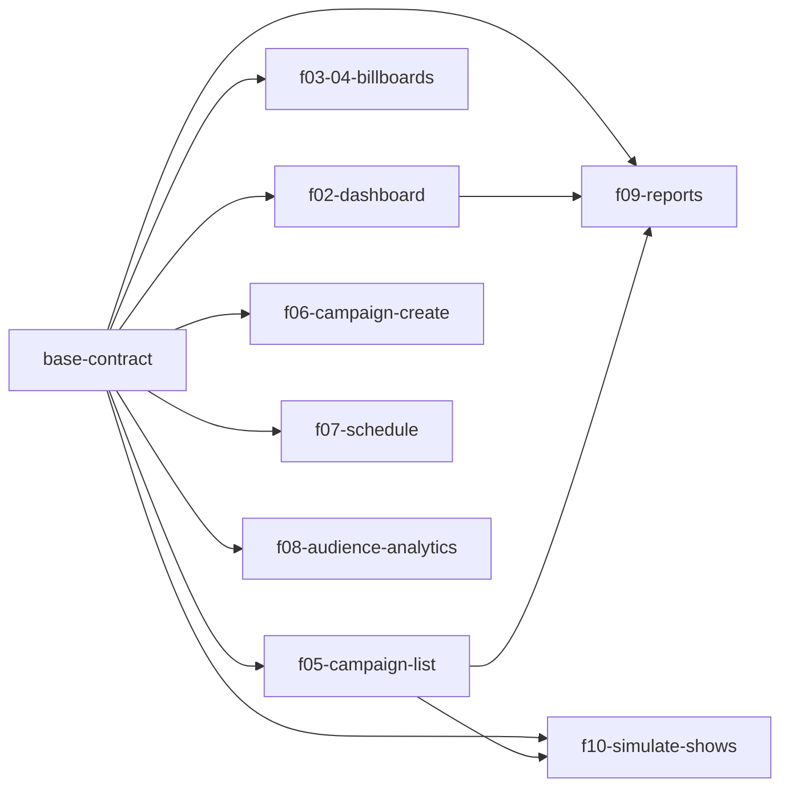

Status: approved 2026-10-28 (auto)

# Build plan

## Contract
LOCKED: base-contract @ e6447e4 on 2026-10-28
Rule: a change to schema, roles, access, statuses or shared signatures needs a new change `contract-<slug>` (its gate: `rules/core.md` "Human gates").

## Changes

| Change | Wave | SoW § | Complexity | Agent | Model | Reason | Depends on | Status | Branch | Worktree | Note |
|---|---|---|---|---|---|---|---|---|---|---|---|
| base-contract | 0 | - | hard | echo-sdlc:backend-builder | opus | shared contract | - | archived | change/base-contract | - | locked |
| f02-dashboard | 1 | 4.2 | hard | echo-sdlc:backend-builder + echo-sdlc:frontend-builder | opus | 100 screens x 366 days aggregated in one reactive query plus the D-4 formula reused by f09; backend query then dashboard UI | base-contract | planned | - | - | f09 reuses the D-4 helper `estimateContacts` |
| f03-04-billboards | 1 | 4.3, 4.4 | hard | echo-sdlc:backend-builder + echo-sdlc:frontend-builder | opus | Leaflet/OSM map with failure isolation and a card that must match the shared slot packing; `screens.list` backend plus list/map/card UI | base-contract | planned | - | - | |
| f06-campaign-create | 1 | 4.6 | hard | echo-sdlc:backend-builder + echo-sdlc:frontend-builder | opus | server-side slot conflict check under concurrent saves plus a rate-limited upload; backend mutation then create form | base-contract | planned | - | - | adds «Создать кампанию» link and `/campaigns/new` route on f05's list page; shared files, see Wave 1 follow-ups |
| f05-campaign-list | 1 | 4.5 | routine | echo-sdlc:routine-builder | opus | read-only queries and list/detail screens over base tables and locked lib math | base-contract | planned | - | - | owns `/campaigns/:id` and `campaigns.get` (G-1) |
| f07-schedule | 1 | 4.7 | routine | echo-sdlc:routine-builder | opus | read-only view over the shared hourSlots; no writes, no new rules | base-contract | planned | - | - | |
| f08-audience-analytics | 2 | 4.8 | routine | echo-sdlc:routine-builder | opus | one read query over the locked audience generator plus a filtered view with cards and a chart | base-contract | planned | - | - | merged into the last wave (script wave 2 had only this change) |
| f09-reports | 2 | 4.9 | routine | echo-sdlc:routine-builder | opus | read-only report from locked lib math and the f02 contacts helper plus a print stylesheet | base-contract, f02-dashboard, f05-campaign-list | planned | - | - | needs f02 and f05 merged (wave 1) |
| f10-simulate-shows | 2 | 4.10 | routine | echo-sdlc:routine-builder | opus | one mutation reusing the locked show-log helper plus one button on the f05 card | base-contract, f05-campaign-list | planned | - | - | also batches `demo.reset` showLog deletes (implementation only, no signature change; 31-day cap is per campaign) |

## Waves

### Wave 1
Changes: f02-dashboard, f03-04-billboards, f06-campaign-create, f05-campaign-list, f07-schedule
E2E: none (`mid` on wave ceil(N/2) when N >= 3: the full E2E checkpoint)
Result: - (wave-review writes PASS or KNOWN-ISSUES (KI-NN), QA: fast|e2e, the date and the wave merge commit)
Follow-ups: - (`[medium]` and lower review findings)
Merge note: f06 adds the «Создать кампанию» link and the `/campaigns/new` route on f05's list page. Expect merge conflicts in `src/routes/Campaigns.tsx`, `src/shell/AppShell.tsx`, `convex/campaigns.ts` and `shared/strings/ru.ts`. Each change keeps its own strings namespace; merge f05 first, then f06.

### Wave 2
Changes: f08-audience-analytics, f09-reports, f10-simulate-shows
E2E: none (`mid` on wave ceil(N/2) when N >= 3: the full E2E checkpoint)
Result: - (wave-review writes PASS or KNOWN-ISSUES (KI-NN), QA: fast|e2e, the date and the wave merge commit)
Follow-ups: - (`[medium]` and lower review findings)
Wave note: the script gave 3 waves (5 / 1 / 2). f08 depends only on base-contract and would sit alone in wave 2, so it joins the last wave (3 changes): f09 needs f02 and f05, f10 needs f05, all in wave 1. `checkpoint.mjs --waves 2` prints `E2E_MID: none`.

## Dependency graph

## Open items
- None. No build-blocking `TODO(client)` items.
